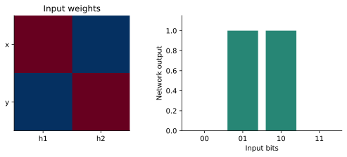

# Boolean circuits with fixed weights

Construct a two-unit network that computes exclusive OR on every binary input.

The hidden units compute the positive and negative parts of x minus y. Summing their rectified outputs gives the absolute difference. On binary inputs that equals XOR. This specifies every parameter before any examples are evaluated.

[Worked notebook](boolean_circuits_with_fixed_weights.ipynb) · [Python script](boolean_circuits_with_fixed_weights.py)

## Construct the weights and test their behaviour

Inspect the arrays and the reference output. Each check describes a specific property of the constructed model.

## Recorded output

```text
x y | h1 h2 | XOR
[[0 0 0 0 0]
 [0 1 0 1 1]
 [1 0 1 0 1]
 [1 1 0 0 0]]
```

## Interpreting the result

All four inputs can be tested exhaustively. Away from those four points the same network computes an absolute difference.



## Exercise

Construct AND with one rectifier and test it on the same truth table.

## References

[McCulloch and Pitts, threshold logic (1943)](https://doi.org/10.1007/BF02478259)

[WeightCode, weight-space programming preprint (2026)](https://arxiv.org/abs/2611.25476)
