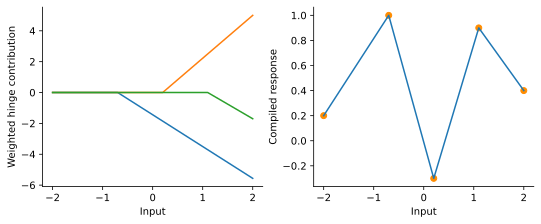

# Compiling a piecewise linear function

Turn a table of knots and heights into the weights of a rectifier network.

Start with the first segment slope. At each interior knot, add a hinge with a weight equal to the change in slope. A skip connection carries the initial straight line. Endpoint extrapolation follows the first and last slopes.

[Worked notebook](compiling_a_piecewise_linear_function.ipynb) · [Python script](compiling_a_piecewise_linear_function.py)

## Construct the weights and test their behaviour

Inspect the arrays and the reference output. Each check describes a specific property of the constructed model.

## Recorded output

```text
slope changes [-2.06   2.778 -1.889] maximum grid error 9.44e-16
```

## Interpreting the result

The location of a kink is a bias. Its signed change of slope is an output weight. Both can be edited independently.



## Exercise

Insert one extra knot on a straight segment and predict the added weight.

## References

[Unser, a representer theorem for deep neural networks (2019)](https://www.jmlr.org/papers/v20/18-418.html)

[WeightCode, weight-space programming preprint (2026)](https://arxiv.org/abs/2611.25476)
