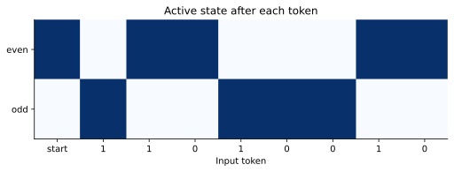

# Finite-state transition matrices

Compile a parity recogniser into one transition matrix for each input symbol.

Represent even and odd parity by one-hot row vectors. Reading zero preserves the state and reading one exchanges the two coordinates. The recurrent update multiplies by the matrix selected by the current symbol.

[Worked notebook](finite_state_transition_matrices.ipynb) · [Python script](finite_state_transition_matrices.py)

## Construct the weights and test their behaviour

Inspect the arrays and the reference output. Each check describes a specific property of the constructed model.

## Recorded output

```text
words tested 511 state path [0 1 0 0 1 1 1 0 0]
```

## Interpreting the result

The induction step is visible in the two matrices. One preserves parity, the other toggles it, which extends the finite test to words of any length.



## Exercise

Compile a three-state machine that counts ones modulo three.

## References

[Stanford CS103, finite automata and regular languages](https://web.stanford.edu/class/cs103/)

[WeightCode, weight-space programming preprint (2026)](https://arxiv.org/abs/2611.25476)
