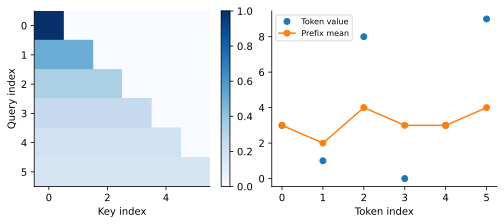

# Programming a causal attention head

Choose query, key and value matrices so each token reports the running mean.

Set query and key projections to zero. After a causal mask, every visible key receives the same finite logit, so softmax gives equal weight to the prefix. An identity value projection preserves the features being averaged.

[Worked notebook](programming_a_causal_attention_head.ipynb) · [Python script](programming_a_causal_attention_head.py)

## Construct the weights and test their behaviour

Inspect the arrays and the reference output. Each check describes a specific property of the constructed model.

## Recorded output

```text
running means [3. 2. 4. 3. 3. 4.]
max error 4.440892098500626e-16
```

## Interpreting the result

Masking future positions is part of the computation. Zero logits alone would average the entire sequence. This head illustrates one operation found in program-to-transformer work.



## Exercise

Change the mask to include only the current and preceding two tokens.

## References

[Vaswani et al., Attention Is All You Need (2017)](https://arxiv.org/abs/1706.03762)

[Weiss, Goldberg and Yahav, Thinking Like Transformers (2021)](https://proceedings.mlr.press/v139/weiss21a.html)

[Lindner et al., Tracr (2023)](https://arxiv.org/abs/2301.05062)
