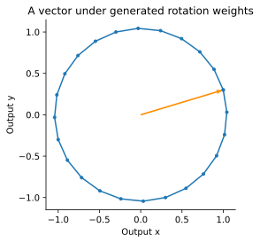

# Generating weights with a hypernetwork

Generate a family of two-dimensional linear maps from an angle.

A hypernetwork outputs the parameters of another network. Here the conditioning features are cosine and sine. A fixed linear generator arranges these values into a rotation matrix. The choice of features builds the group structure into the generator.

[Worked notebook](generating_weights_with_a_hypernetwork.ipynb) · [Python script](generating_weights_with_a_hypernetwork.py)

## Construct the weights and test their behaviour

Inspect the arrays and the reference output. Each check describes a specific property of the constructed model.

## Recorded output

```text
largest orthogonality error 1.61e-16
```

## Interpreting the result

The generated maps preserve length. A learned hypernetwork would need data or architectural constraints to acquire that property.



## Exercise

Add a separate input scale and state which test should now fail.

## References

[Ha, Dai and Le, HyperNetworks (2016)](https://arxiv.org/abs/1609.09106)
