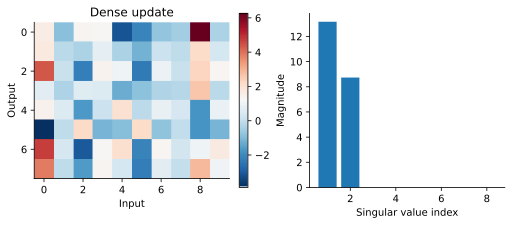

# Low-rank adapters and weight merging

Express a low-rank update in factored form and merge it into a base matrix.

LoRA represents an update as a product B A, often scaled by alpha divided by rank. During evaluation the factored branch and the merged weight apply the same linear map. This example specifies the factors directly so the comparison is exact.

[Worked notebook](low_rank_adapters_and_weight_merging.ipynb) · [Python script](low_rank_adapters_and_weight_merging.py)

## Construct the weights and test their behaviour

Inspect the arrays and the reference output. Each check describes a specific property of the constructed model.

## Recorded output

```text
rank 2 factor parameters 36 dense 80 maximum difference 5.33e-15
```

## Interpreting the result

The parameter saving depends on rank and layer shape. Merger equivalence checks the arithmetic, while learned task quality requires a separate evaluation.



## Exercise

Increase the rank until the factor count exceeds the dense matrix size.

## References

[Hu et al., LoRA (2021)](https://arxiv.org/abs/2106.09685)

[NumPy, singular value decomposition](https://numpy.org/doc/stable/reference/generated/numpy.linalg.svd.html)
