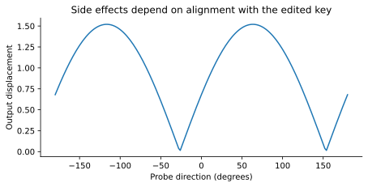

# A minimum-change rank-one edit

Impose a new output at one key while measuring how the edit affects other inputs.

For a nonzero key k with desired residual e, the minimum-Frobenius-norm update is e kᵀ / (kᵀk). Every row solves one minimum-norm linear constraint. Orthogonal inputs are unchanged. This is a single linear-layer derivation related to rank-one editing.

[Worked notebook](a_minimum_change_rank_one_edit.ipynb) · [Python script](a_minimum_change_rank_one_edit.py)

## Construct the weights and test their behaviour

Inspect the arrays and the reference output. Each check describes a specific property of the constructed model.

## Recorded output

```text
rank 1 key residual 2.220446049250313e-16 orthogonal drift 0.0
```

## Interpreting the result

A successful edit at the key does not guarantee locality on nearby inputs. The plotted directions measure that side effect directly.



## Exercise

Find the directions with zero drift analytically and compare with the curve.

## References

[Meng et al., Locating and Editing Factual Associations in GPT (2022)](https://arxiv.org/abs/2202.05262)

[WeightCode, weight-space programming preprint (2026)](https://arxiv.org/abs/2611.25476)
