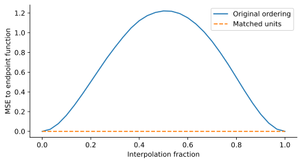

# Permutation alignment before averaging

Recover the hidden-unit correspondence between two equivalent networks.

Permuting hidden units and applying the same permutation to outgoing weights preserves the function. Fit an assignment using incoming weights and biases, reorder the second model, then compare interpolation errors before and after alignment. This is the one-hidden-layer case of weight matching.

[Worked notebook](permutation_alignment_before_averaging.ipynb) · [Python script](permutation_alignment_before_averaging.py)

## Construct the weights and test their behaviour

Inspect the arrays and the reference output. Each check describes a specific property of the constructed model.

## Recorded output

```text
raw midpoint MSE 1.22093, aligned 0.00e+00
```

## Interpreting the result

Two endpoints can agree on every input and still interpolate poorly. The assignment succeeds here because one model is an exact permutation of the other.



## Exercise

Perturb the second model before matching and measure the remaining interpolation error.

## References

[Ainsworth et al., Git Re-Basin (2022)](https://arxiv.org/abs/2209.04836)
