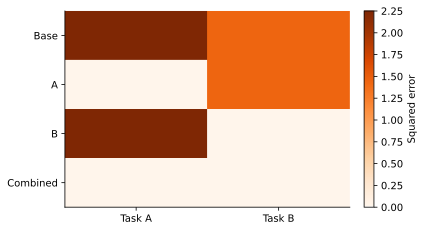

# Task vector arithmetic

Combine parameter displacements measured from a common starting point.

A task vector is the difference between a task checkpoint and the shared base. A linear regressor on orthogonal input features gives an example where two independent edits compose exactly. A correlated-feature counterexample shows when both tasks cannot be satisfied simultaneously.

[Worked notebook](task_vector_arithmetic.ipynb) · [Python script](task_vector_arithmetic.py)

## Construct the weights and test their behaviour

Inspect the arrays and the reference output. Each check describes a specific property of the constructed model.

## Recorded output

```text
squared errors for tasks A and B
[[2.25 1.44]
 [0.   1.44]
 [2.25 0.  ]
 [0.   0.  ]]
best shared prediction for conflicting targets 0.0 irreducible mean squared error 1.0
```

## Interpreting the result

Composition is exact in the two independent coordinates. Conflicting labels on an identical input give a positive joint error for any deterministic model.



## Exercise

Rotate one task feature gradually and plot the combined error.

## References

[Ilharco et al., Editing Models with Task Arithmetic (2022)](https://arxiv.org/abs/2212.04089)
