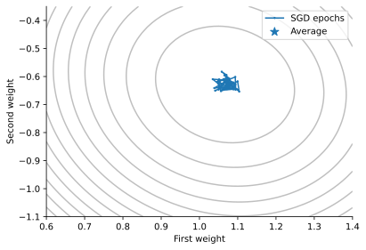

# Stochastic weight averaging

Average late SGD checkpoints and measure train and test error at the averaged point.

Use a fixed learning rate to keep iterates moving around a least-squares optimum. Save late epoch checkpoints, average them in parameter space and compare against the final iterate on fresh noisy observations. A convex two-weight problem makes the loss surface visible.

[Worked notebook](stochastic_weight_averaging.ipynb) · [Python script](stochastic_weight_averaging.py)

## Construct the weights and test their behaviour

Inspect the arrays and the reference output. Each check describes a specific property of the constructed model.

## Recorded output

```text
late checkpoints 28 test MSE final and averaged [0.3576 0.3621]
```

## Interpreting the result

The average lies inside the late trajectory. Whether its test error improves is an empirical outcome, and the single run gives no general performance guarantee.



## Exercise

Change the averaging start epoch and plot held-out error against the number of checkpoints.

## References

[Izmailov et al., Averaging Weights Leads to Wider Optima (2018)](https://arxiv.org/abs/1803.05407)
